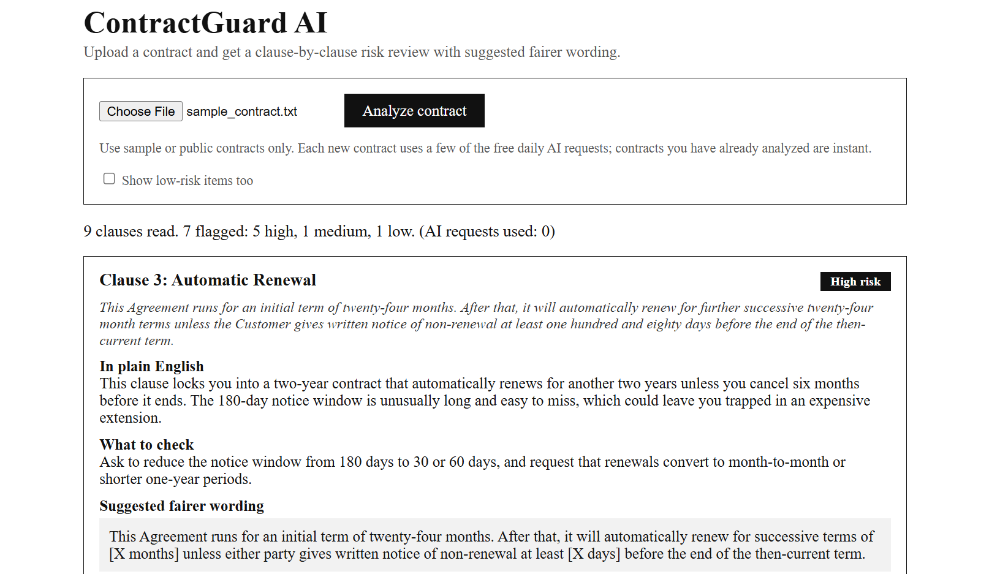
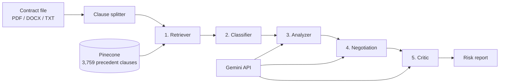

# ContractGuard AI

**An agentic assistant that reads a contract, flags risky clauses, explains them in plain English, and suggests fairer wording.**

Built as a 5th-semester MDC project (Computer Science and Engineering) following the V.E.T.S framework.



## The problem

Startups and small businesses routinely sign contracts (vendor agreements, NDAs, leases) without a lawyer reading them, because legal review is costly and slow. Risky clauses such as automatic renewals, unlimited liability, one-sided termination or giving away ownership of your own work often go unnoticed until they cause harm. Business owners usually cannot tell which clauses are normal and which are dangerous.

## What it does

1. Reads a contract (`.pdf`, `.docx` or `.txt`) and splits it into clauses.
2. Finds similar real clauses from the CUAD legal dataset, so judgements rest on precedent and not guesswork.
3. Labels each clause type and explains the risk in plain English.
4. Suggests fairer wording, with a fallback to ask for if the other side refuses.
5. Has a second AI reviewer (the Critic) check the explanations and rewrites for added facts, changed meaning and over-strong wording.

## How it works

Five agents, built with LangGraph, each with one job:



| Agent | Job |
|---|---|
| Retriever | Embeds each clause and searches Pinecone for the most similar precedent clauses |
| Classifier | Decides the clause type by similarity voting among the retrieved clauses |
| Analyzer | Uses Gemini to explain the risk in plain English and rate it Low, Medium or High |
| Negotiation | Uses Gemini to rewrite risky clauses more fairly, with a fallback request |
| Critic | Reviews the explanation and rewrite, and corrects overreach; a rule-based check also flags any new figures not in the original clause |

Why several agents instead of one prompt: each step has one job, so the next agent can catch the previous one's mistakes. For example, the Classifier labelled an unlimited-liability clause as "Cap On Liability", and the Analyzer corrected it.

## Results so far

**Classifier (similarity voting, no LLM involved)**, tested on 300 real CUAD clauses (20 from each of 15 risky clause types) with each clause's own contract hidden from the search. Run `python evaluate.py` to reproduce; the full output is in `evaluation_results.txt`.

- Clause-type accuracy: **70.0%** (210 / 300). Guessing would score about 6.7%.
- Strongest types: Liquidated Damages and Renewal Term (100%), Termination For Convenience (90%).
- Weakest types: Most Favored Nation (25%) and Notice Period To Terminate Renewal (0%), which is mostly confused with Renewal Term.

**Similarity threshold trade-off** (150 harmless governing-law, party and date clauses used to measure false alarms):

| Threshold | Risky clauses flagged | Harmless clauses wrongly flagged |
|---|---|---|
| 0.50 | 62.3% | 13.3% |
| **0.45 (used)** | **83.0%** | **33.3%** |
| 0.40 | 92.7% | 60.0% |

A lower threshold was chosen because missing a dangerous clause is worse than an extra flag; the Analyzer rates harmless items Low and the web page hides low-risk items by default.

**Sample contract** (`sample_contract.txt`, 9 clauses, checked by hand; a small preliminary test): the Classifier alone got 7 of 9 right, and 9 of 9 after the Analyzer. Batching and saved results reduced AI calls from about 12 to 2 per contract.

## Tech stack

| Purpose | Tool |
|---|---|
| Language | Python |
| Agent orchestration | LangGraph |
| Language model | Google Gemini API (free tier) |
| Vector database and embeddings | Pinecone (`llama-text-embed-v2`) |
| Dataset | CUAD, The Atticus Project |
| File reading | `pypdf` (PDF), built-in zip/XML reader (Word) |
| Web app | FastAPI, plain HTML page |

## Project files

| File | Purpose |
|---|---|
| `app.py`, `index.html` | The web app: upload a contract, see the report |
| `pipeline5.py` | The full pipeline with all five agents (main version) |
| `pipeline4.py` | Batched Analyzer and Negotiation agents, plus saved-results cache |
| `pipeline.py` | Clause splitting, Retriever and Classifier |
| `pipeline2.py`, `pipeline3.py` | Earlier versions, kept as development history |
| `contract_reader.py` | Reads PDF, Word and text files and splits them into clauses |
| `run_contract.py` | Command-line runner: `python run_contract.py file.pdf` |
| `evaluate.py`, `evaluation_results.txt` | Accuracy test and its output |
| `download_cuad.py`, `explore_cuad.py`, `prepare_clauses.py`, `load_pinecone.py` | One-time dataset setup |
| `search_test.py`, `test_gemini.py` | Small connection tests |
| `sample_contract.txt`, `sample_vendor_agreement.pdf` | Fictional sample contracts for testing |

## Setup and run

You need Python 3.10 or newer, a free [Google AI Studio](https://aistudio.google.com) API key and a free [Pinecone](https://app.pinecone.io) API key.

```bash
git clone https://github.com/RonakdeepSingh/ContractGuard_AI.git
cd ContractGuard_AI
python -m pip install langgraph langchain-google-genai python-dotenv pinecone pypdf fastapi uvicorn python-multipart
```

Create a file named `.env` in the project folder (it is git-ignored, never commit it):

```
GOOGLE_API_KEY=your_google_key
PINECONE_API_KEY=your_pinecone_key
```

One-time dataset setup:

```bash
python download_cuad.py       # downloads CUAD into data/
python prepare_clauses.py     # builds clauses.json (already included in the repo)
python load_pinecone.py       # creates the Pinecone index and uploads the clauses
```

Run the web app:

```bash
python -m uvicorn app:app
```

Then open http://127.0.0.1:8000 and upload a contract. Or use the command line:

```bash
python run_contract.py sample_contract.txt
```

**About the free Gemini limits:** at the time of writing, the free tier allowed 5 requests per minute and 20 per day for `gemini-3.8-flash`. Every Gemini answer is saved in `cache.json`, so analysing the same contract again costs nothing. Model names change over time; if Google renames the model, change `GEMINI_MODEL` at the top of `pipeline4.py`.

## Limitations and future work

- The Classifier is a similarity-voting baseline; a fine-tuned classifier (for example LegalBERT) is planned and would be compared against the 70.0% baseline.
- The Critic is an AI reviewing AI output. It reduces mistakes but does not remove them, so the report shows its verdicts and a human should read the suggestions.
- Tested on one small sample contract plus the CUAD evaluation; a larger test on more contracts is still needed.
- The false-alarm estimate uses only governing-law, party and date clauses as "harmless" examples.
- Scanned (image-only) PDFs cannot be read yet; OCR is a possible addition.
- Planned: accept/reject feedback on suggestions, stored to improve results over time.
- The free API limits make heavy use impractical.

## V.E.T.S mapping

| | How ContractGuard meets it |
|---|---|
| **V**iability | Free tools only (Gemini, Pinecone, open CUAD dataset) |
| **E**ngineering depth | Multi-agent pipeline with retrieval, batching, caching and a verification step |
| **T**rend | Agentic AI (LangGraph) |
| **S**ocial impact | Affordable contract review for startups and small businesses |

## Team

- Ronak Deep Singh, Roll No. 2024A1R143, CSE, Semester 5
- Mehfooz, Roll No. 2024A1R180, CSE, Semester 5

## Credits and disclaimer

- Dataset: *CUAD: An Expert-Annotated NLP Dataset for Legal Contract Review* by Hendrycks, Burns, Chen and Ball (2021), released by The Atticus Project. See their repository for license terms.
- **This is a student project. Its output is AI-generated and is not legal advice.** Do not use it for real contracts without review by a qualified lawyer, and only upload sample or public contracts.
